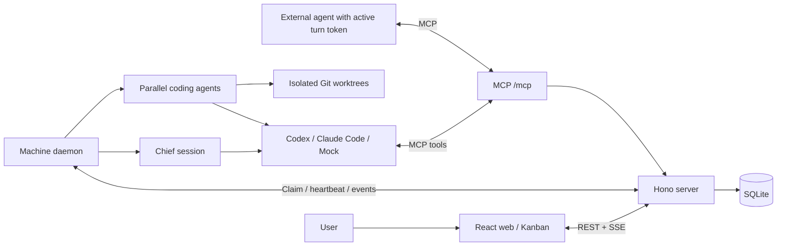

# Muster

Muster is an open-source, self-hostable [todos.dev](https://todos.dev)-style workspace for working with coding agents. Talk to a **Chief** that breaks goals into todos and orchestrates agents, then follow their progress on a live Kanban board.

- Run agents in parallel, each in an isolated Git worktree and branch.
- Choose **Plan first** with a Confirm gate, or **Run now**; review versioned plans and diffs before accepting and merging changes.
- Use **Codex** and **Claude Code** runtimes, send feedback during a run, and track basic token usage and duration.
- Connect Chief and external agents through the same authenticated **MCP** endpoint.


## Agent resources

- Agent profiles with editable duties, run defaults, default skills, permissions, and per-agent memory.
- A skills library with folder/bulk uploads and public GitHub imports; review metadata before importing. Skills are cached per content hash on each daemon, outside task worktrees.
- Encrypted, write-only team/project secrets, permission-gated delivery to runtime shells, output redaction, and Chief secure-input cards. Project values override matching team values; authorized plan turns also receive secrets.
- Agent and skill mentions in Chief, task conversations, and new-task descriptions. English and Simplified Chinese UI.

See [architecture and limits](docs/ARCHITECTURE.md#phase-a-agent-resources) for the local trust model, runtime verification, and import limits.

## Schedules and connections

- Repeat an existing task hourly, daily, weekly, or once from **Schedules** or the
  task's **Repeat…** button. Each run starts a fresh build/branch from its title and
  spec, with the usual Confirm/Review gates. Time zones and DST are respected; busy
  tasks skip that occurrence and missed runs collapse into one.
- **Connections** includes Linear, GitHub, Notion (OAuth unavailable), Playwright,
  and custom HTTP/stdio MCP servers. Connect a service, then grant it on an agent's
  profile. Header/env values are encrypted and write-only; decrypted values never
  enter claim journals and are redacted from daemon uploads.
- Local stdio connections are pinned to a selected machine in the UI. They are
  omitted on other machines. HTTP tests initialize MCP and list tools; stdio starts
  on the next agent run. OAuth sign-in is not supported yet.
- Codex marks user-granted MCP tools `approve`; plan turns retain their read-only
  filesystem sandbox. MCP services can still expose write actions, so scope provider
  tokens appropriately. CLI and provider credentials remain under the daemon user's
  trust boundary.

See [Phase B architecture](docs/ARCHITECTURE.md#phase-b-schedules-and-connections) for
API contracts, catalog source URLs, verified CLI versions and limits.

## Settings and external assistants

Open **Settings** from the sidebar or **⌘,**. General stores language, appearance
and workspace name on the server. Notifications controls desktop alerts for
confirmation, review, failure and completion, plus the Dock badge. The API keys
tab creates revocable keys: copy the full key immediately, because it is shown
only once. `read` grants read-only board tools; `chief` also grants task control,
topic messages (queueing Chief) and schedule creation. Both scopes can use MCP.

The MCP tab provides setup and copyable client snippets using the current origin.
Replace `http://localhost:7420` below with your workspace URL, and `<key>` with your
key. API keys authenticate `/api/mcp`; other REST routes retain the trusted-local
hosting model described below.

Claude Code (**2.1.310**, verified with local `mcp add --help`):

```sh
claude mcp add --transport http muster http://localhost:7420/api/mcp --header "Authorization: Bearer <key>"
```

Codex (**codex-cli 0.162.1**, local help and configuration parser verified), in
`~/.codex/config.toml`:

```toml
[mcp_servers.muster]
url = "http://localhost:7420/api/mcp"
http_headers = { Authorization = "Bearer <key>" }
```

Cursor / generic MCP JSON (the Cursor client itself was not exercised):

```json
{
  "mcpServers": {
    "muster": {
      "url": "http://localhost:7420/api/mcp",
      "headers": { "Authorization": "Bearer <key>" }
    }
  }
}
```

## Projects and task input

Open a project from its card or the sidebar. Files browses committed files on the
base branch with lazy folders, markdown/text previews and the last 100 commits;
select a commit to view its diff. Only absolute local repository paths accessible
to the server are supported. No fetch or checkout occurs. File previews are capped
at 1 MB; binary files show a notice. Git reads time out after eight seconds and
commit diffs are capped at 4 MB. Tasks supports search, phase/agent filters,
sorting and list/grid views. Project Settings edits name, description and base
branch; projects referenced by tasks cannot be deleted.

New task supports project selection, a structured description, tags, mentions and
up to 10 attachments / 20 MB total. Save keeps the task in Backlog; Save & start
uses the remembered Plan first / Run now choice (⌘Enter). The daemon downloads
attachments into its external `attachments-cache` and supplies absolute paths in
the prompt; files are not copied into the worktree. Server attachments are removed
on task deletion; daemon cache pruning is manual. CLI sandbox access to external
paths depends on the installed runtime. Chief's starter tiles help import a project
or skill and fill example prompts.

## Keyboard shortcuts

Use Command on macOS or Ctrl elsewhere. **⌘/** opens this list anywhere.

| Keys | Action |
| --- | --- |
| ⌘K / ⌘P / ⌘J | Search all / tasks / topics |
| ⌘N / N | New task (plain N only outside inputs) |
| ⌘[ | Back |
| ⌘B | Toggle sidebar |
| ⌘⌥B | Toggle board/right panel |
| ⌘⇧Enter | Maximize/restore right panel |
| ⌘⌥Enter | Done/merge at Review, outside inputs |
| ⌘, / ⌘/ | Settings / keyboard shortcuts |
| Esc | Close dialog |
| ⌘Enter | Save & start in the new-task dialog |

## Quick start

Install Node.js 22 or newer (a current Node 22 release is recommended; see [.nvmrc](.nvmrc)), npm, and Git. Run these commands from the repository root:

```sh
npm install
npm run dev
```

In a second terminal:

```sh
npm run daemon
```

Open <http://localhost:5173>. The API listens on port 7420; Vite proxies API, SSE, and MCP requests to it.

1. Add a project using a local Git repository path or Git URL and its base branch. The repository must have an initial commit and be accessible from the daemon machine.
2. Create an agent with a runtime and model. Make sure the corresponding CLI is available to the daemon (see below).
3. Create a todo with **Plan first**, confirm the plan, review the resulting changes, then mark it Done to merge back to the base branch. **Run now** skips the plan gate.
4. Ask Chief to split a goal into tasks and start them in parallel.

For a model-free trial, select the `mock` runtime and model for a coding agent and Chief in Agents. Send Chief `/split Try Muster` after adding a project and a non-Chief mock agent. Mock creates deterministic changes in `MUSTER_MOCK.md`; it does not call a model API.

## Production

```sh
npm install
npm run build && npm start
```

Open <http://localhost:7420>. The server serves the built web app and API together. Run `npm run daemon` in a separate terminal or process supervisor to execute tasks. Persist the server data and daemon home directories across restarts.

Muster currently targets a single user on a trusted local machine. Web/API login and multi-user access control are deferred. The enrollment key protects machine enrollment only. Keep the service on loopback or behind your own authenticated access layer when hosting remotely. Writable model turns run with elevated permissions; use repositories and machines you trust.

## Desktop app

On macOS, run the whole local workspace in one app:

```sh
npm install
npm run desktop:dev
# Build an ad-hoc signed Muster.app and DMG for this Mac's architecture:
npm run desktop:dist
# Optional hidden-window check of the packaged app, using only mock turns:
npm run desktop:smoke
```

Builds are written to `apps/desktop/release/` (`mac-arm64/Muster.app` on Apple Silicon, `mac/Muster.app` on Intel). The app bundles Electron's Node, server, daemon and web UI; users do not need a system Node installation to run it. Install/authenticate Git and any desired `codex` or `claude` CLIs separately. Windows NSIS and Linux AppImage targets are configured for native builds on those platforms.

Launching starts a loopback server on 7420 (or the next free port), automatically enrolls this machine, and opens the workspace. An existing Muster server is reused. Data lives in `~/.muster`, with desktop worker logs in `~/.muster/logs`. Quit waits for owned daemon turns to report stopped before stopping its server. Attached services remain running. Native folder selection, clickable absolute conversation paths, gate notifications, a Needs-you dock badge, and a status menubar icon are included. The File menu provides New task (⌘N), Open in browser and Show logs.

See [desktop architecture and runtime verification](docs/ARCHITECTURE.md#desktop-m6) for the bundled `node:sqlite` check, PATH discovery and shutdown behavior.

## Configuration

Set environment variables in the process environment; Muster does not automatically load `.env` files.

| Variable | Default | Purpose |
| --- | --- | --- |
| `HOST` | `127.0.0.1` | Server bind address. |
| `PORT` | `7420` | Server port. Vite's development proxy targets 7420. |
| `MUSTER_DATA_DIR` | `~/.muster` | Server directory containing `muster.db`. |
| `MUSTER_PUBLIC_URL` | `http://127.0.0.1:<port>` | Server origin used to construct MCP URLs; must be reachable from the daemon. |
| `MUSTER_ENROLL_KEY` | Unset | Optional enrollment secret; set the same value on server and daemon. |
| `MUSTER_CLAIM_WAIT_MS` | `25000` | Server long-poll timeout in milliseconds. |
| `MUSTER_CHIEF_AUTO_FOLLOW_UP` | `true` | Set to `false` to disable automatic Chief follow-up turns. |
| `MUSTER_HOME` | `~/.muster` | Daemon registration, journal, logs, Chief sessions, and workspaces. |
| `CHOKIDAR_USEPOLLING` | `true` in root dev script | Set to `false` to use native development file watching. |

Daemon options include `--server`, `--name`, `--concurrency` (default 6, range 1–64), and `--workspaces-dir`. For example:

```sh
npm run daemon -- --concurrency 2 --name laptop
# After building, connect directly to another server:
npm exec -- muster-daemon start --server http://server-host:7420
```

For remote daemons, set `HOST` and a reachable `MUSTER_PUBLIC_URL` on the server. Each machine needs its own daemon home and access to the project repositories. Continued builds stay on their assigned machine; restarting a failed build permits another machine to claim a new worktree.

## Runtime setup

Install and authenticate the CLIs you want to use on the **daemon machine**, under the user running the daemon. Confirm `codex --version` or `claude --version` works in that shell, then start or restart the daemon. It advertises installed executables from `PATH`; `mock` is always available. Muster reuses the CLI's authentication and does not manage provider credentials.

- **Codex:** the adapter launches `codex app-server` over stdio, resumes threads, and injects the Muster MCP configuration per turn. The integration was checked against codex-cli 0.162.1. Plan turns use a read-only sandbox; writable turns use `danger-full-access` with approvals disabled.
- **Claude Code:** the adapter launches `claude` with stream-json input/output, partial messages, and per-process MCP configuration. The integration was checked against Claude Code 2.1.310. Plan turns use permission mode `plan`; writable turns use `bypassPermissions`.
- Choose a model available to your CLI account in the Agents editor. The seeded Chief uses Codex; change its runtime/model there if you use Claude or mock instead.

Live provider calls are outside automated validation. Adapter tests use local protocol peers and mock runs. See the [daemon guide](apps/daemon/README.md) for protocol details and Git merge behavior.

## Architecture



`packages/shared` holds domain types and schemas; `apps/server` owns persistence and orchestration; `apps/daemon` manages worktrees and runtimes; `apps/web` provides the workspace. Production serves the web bundle from the server. MCP uses Streamable HTTP and requires a per-turn bearer token valid during an active turn; a machine token cannot authenticate MCP.

Read [the spec](docs/PLAN.md), [architecture and API contracts](docs/ARCHITECTURE.md), and [web guide](apps/web/README.md) for details.

## Roadmap

The MVP includes orchestration, Kanban, plan/review gates, worktrees, Codex/Claude runtimes, machine daemons, MCP, and basic usage reporting. Features deferred in [PLAN §1](docs/PLAN.md#1-调研结论todosdev-关键机制) include:

- Additional runtimes and built-in pi.
- Teams, multiple users, and login.
- AI review and OAuth sign-in for connections.
- Mobile clients, cloud machines, and GitHub pull request integration.

## Contributing

See [CONTRIBUTING.md](CONTRIBUTING.md) for setup, project conventions, and checks. Bug reports and focused pull requests are welcome.

## License

[MIT](LICENSE), copyright 2026 Wale Shi.

## 中文

Muster 是开源、可自托管的 todos.dev 风格编码协作工作台。你与 Chief 对话，由它拆分任务并调度多个 Agent，在独立 Git worktree 中并行工作；通过看板跟踪进展，在计划确认和变更验收关口决定下一步。支持 Codex、Claude Code 与 MCP。

需要 Node.js 22+、npm 和 Git。运行 `npm install`、`npm run dev`，另开终端运行 `npm run daemon`，访问 <http://localhost:5173>。生产模式运行 `npm run build && npm start`，访问 <http://localhost:7420>。当前面向单用户可信本地环境；完整方案见 [docs/PLAN.md](docs/PLAN.md)。

### Languages

Muster supports English and Simplified Chinese. Choose a language in Settings → General; changes apply to the web UI and desktop menus. Language and appearance are stored server-side and cached locally for startup. A new workspace defaults to English and system appearance. Desktop menus initially follow system preferences until workspace settings arrive.

To add a web language, add one dictionary file exporting `messages: Messages` (including its native `languageName`) alongside `apps/web/src/i18n/en.ts` and one entry in the locale list in `packages/shared/src/locale.ts`; discovery and the language picker are automatic. Add matching native menu copy in the separate desktop dictionary in `apps/desktop/src/i18n.ts`, and extend automatic language detection if needed. English is the source of truth. Keep named placeholders unchanged, use complete sentences and `{one, other}` plural forms, and format values through `useI18n()`. Run the dictionary, switching and desktop locale tests as well as the normal project checks. User/Agent messages, product names, model IDs, code and Git branches are not translated; unknown external errors remain available verbatim.
