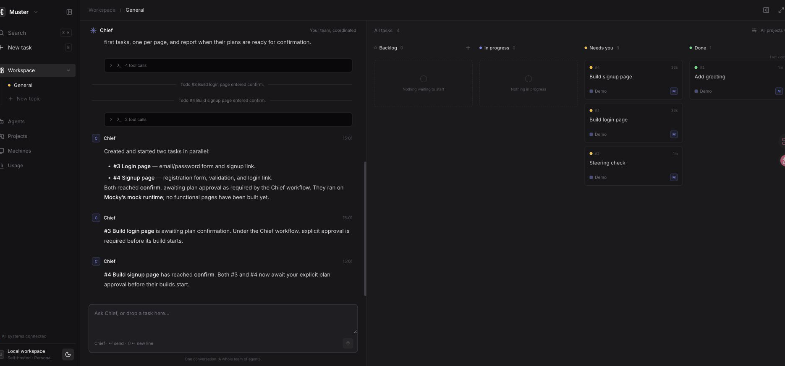
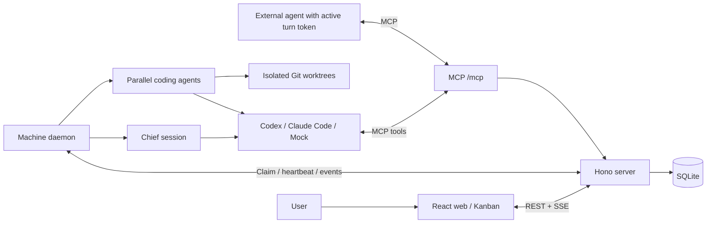

# Muster

Muster is an open-source, self-hostable [todos.dev](https://todos.dev)-style workspace for working with coding agents. Talk to a **Chief** that breaks goals into todos and orchestrates agents, then follow their progress on a live Kanban board.

- Run agents in parallel, each in an isolated Git worktree and branch.
- Choose **Plan first** with a Confirm gate, or **Run now**; review versioned plans and diffs before accepting and merging changes.
- Use **Codex** and **Claude Code** runtimes, send feedback during a run, and track basic token usage and duration.
- Connect Chief and external agents through the same authenticated **MCP** endpoint.




## Quick start

Install Node.js 22 or newer (a current Node 22 release is recommended; see [.nvmrc](.nvmrc)), npm, and Git. Run these commands from the repository root:

```sh
npm install
npm run dev
```

In a second terminal:

```sh
npm run daemon
```

Open <http://localhost:5173>. The API listens on port 7420; Vite proxies API, SSE, and MCP requests to it.

1. Add a project using a local Git repository path or Git URL and its base branch. The repository must have an initial commit and be accessible from the daemon machine.
2. Create an agent with a runtime and model. Make sure the corresponding CLI is available to the daemon (see below).
3. Create a todo with **Plan first**, confirm the plan, review the resulting changes, then mark it Done to merge back to the base branch. **Run now** skips the plan gate.
4. Ask Chief to split a goal into tasks and start them in parallel.

For a model-free trial, select the `mock` runtime and model for a coding agent and Chief in Agents. Send Chief `/split Try Muster` after adding a project and a non-Chief mock agent. Mock creates deterministic changes in `MUSTER_MOCK.md`; it does not call a model API.

## Production

```sh
npm install
npm run build && npm start
```

Open <http://localhost:7420>. The server serves the built web app and API together. Run `npm run daemon` in a separate terminal or process supervisor to execute tasks. Persist the server data and daemon home directories across restarts.

Muster currently targets a single user on a trusted local machine. Web/API login and multi-user access control are deferred. The enrollment key protects machine enrollment only. Keep the service on loopback or behind your own authenticated access layer when hosting remotely. Writable model turns run with elevated permissions; use repositories and machines you trust.

## Configuration

Set environment variables in the process environment; Muster does not automatically load `.env` files.

| Variable | Default | Purpose |
| --- | --- | --- |
| `HOST` | `127.0.0.1` | Server bind address. |
| `PORT` | `7420` | Server port. Vite's development proxy targets 7420. |
| `MUSTER_DATA_DIR` | `~/.muster` | Server directory containing `muster.db`. |
| `MUSTER_PUBLIC_URL` | `http://127.0.0.1:<port>` | Server origin used to construct MCP URLs; must be reachable from the daemon. |
| `MUSTER_ENROLL_KEY` | Unset | Optional enrollment secret; set the same value on server and daemon. |
| `MUSTER_CLAIM_WAIT_MS` | `25000` | Server long-poll timeout in milliseconds. |
| `MUSTER_CHIEF_AUTO_FOLLOW_UP` | `true` | Set to `false` to disable automatic Chief follow-up turns. |
| `MUSTER_HOME` | `~/.muster` | Daemon registration, journal, logs, Chief sessions, and workspaces. |
| `CHOKIDAR_USEPOLLING` | `true` in root dev script | Set to `false` to use native development file watching. |

Daemon options include `--server`, `--name`, `--concurrency` (default 6, range 1–64), and `--workspaces-dir`. For example:

```sh
npm run daemon -- --concurrency 2 --name laptop
# After building, connect directly to another server:
npm exec -- muster-daemon start --server http://server-host:7420
```

For remote daemons, set `HOST` and a reachable `MUSTER_PUBLIC_URL` on the server. Each machine needs its own daemon home and access to the project repositories. Continued builds stay on their assigned machine; restarting a failed build permits another machine to claim a new worktree.

## Runtime setup

Install and authenticate the CLIs you want to use on the **daemon machine**, under the user running the daemon. Confirm `codex --version` or `claude --version` works in that shell, then start or restart the daemon. It advertises installed executables from `PATH`; `mock` is always available. Muster reuses the CLI's authentication and does not manage provider credentials.

- **Codex:** the adapter launches `codex app-server` over stdio, resumes threads, and injects the Muster MCP configuration per turn. The integration was checked against codex-cli 0.162.1. Plan turns use a read-only sandbox; writable turns use `danger-full-access` with approvals disabled.
- **Claude Code:** the adapter launches `claude` with stream-json input/output, partial messages, and per-process MCP configuration. The integration was checked against Claude Code 2.1.310. Plan turns use permission mode `plan`; writable turns use `bypassPermissions`.
- Choose a model available to your CLI account in the Agents editor. The seeded Chief uses Codex; change its runtime/model there if you use Claude or mock instead.

Live provider calls are outside automated validation. Adapter tests use local protocol peers and mock runs. See the [daemon guide](apps/daemon/README.md) for protocol details and Git merge behavior.

## Architecture



`packages/shared` holds domain types and schemas; `apps/server` owns persistence and orchestration; `apps/daemon` manages worktrees and runtimes; `apps/web` provides the workspace. Production serves the web bundle from the server. MCP uses Streamable HTTP and requires a per-turn bearer token valid during an active turn; a machine token cannot authenticate MCP.

Read [the spec](docs/PLAN.md), [architecture and API contracts](docs/ARCHITECTURE.md), and [web guide](apps/web/README.md) for details.

## Roadmap

The MVP includes orchestration, Kanban, plan/review gates, worktrees, Codex/Claude runtimes, machine daemons, MCP, and basic usage reporting. Features deferred in [PLAN §1](docs/PLAN.md#1-调研结论todosdev-关键机制) include:

- Agent memory, skills, and permission controls; additional runtimes and built-in pi.
- Teams, multiple users, and login.
- Schedules, connections, secrets management, and AI review.
- Mobile clients, cloud machines, and GitHub pull request integration.

## Contributing

See [CONTRIBUTING.md](CONTRIBUTING.md) for setup, project conventions, and checks. Bug reports and focused pull requests are welcome.

## License

[MIT](LICENSE), copyright 2026 Wale Shi.

## 中文

Muster 是开源、可自托管的 todos.dev 风格编码协作工作台。你与 Chief 对话，由它拆分任务并调度多个 Agent，在独立 Git worktree 中并行工作；通过看板跟踪进展，在计划确认和变更验收关口决定下一步。支持 Codex、Claude Code 与 MCP。

需要 Node.js 22+、npm 和 Git。运行 `npm install`、`npm run dev`，另开终端运行 `npm run daemon`，访问 <http://localhost:5173>。生产模式运行 `npm run build && npm start`，访问 <http://localhost:7420>。当前面向单用户可信本地环境；完整方案见 [docs/PLAN.md](docs/PLAN.md)。
